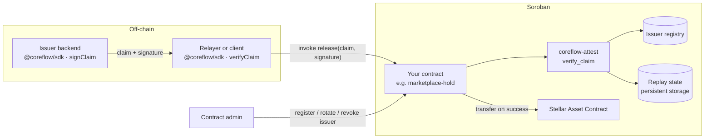

# CoreFlow Kit

**Verify signed off-chain claims in Soroban contracts — with replay protection, expiry and key rotation, plus shared Rust/TypeScript test vectors that keep your signer and your contract byte-identical.**

[](https://github.com/r-json/CoreFlow/actions/workflows/kit.yml)
[](packages/sdk)
[](LICENSE)
[](examples/marketplace-hold)
[](docs/kit/security-model.md#audit-status)

> **0.1.0-alpha — unaudited, Testnet only.** The API and the claim format may
> change before 1.0. Do not use it to protect real value.

---

## The problem

Many Soroban contracts need to act on a fact that happens off-chain: a parcel was
delivered, an inspection passed, a sensor crossed a threshold. The party that
knows the fact is usually a backend service or a device — not a Stellar account
that can sign transactions. So each team writes its own `ed25519_verify` code,
and the same mistakes recur:

- **The signed bytes drift.** The TypeScript signer and the Rust contract serialize the message differently, and every signature fails — or worse, a field silently drops out of what is signed.
- **Replays.** A claim accepted once is accepted again, on the same contract, on another deployment, or on another network.
- **TTL used as an expiry.** Anyone can extend a storage entry's TTL, so it never bounds a claim's lifetime.
- **Replay markers in temporary storage**, which disappear and let a used claim verify again.
- **`ed25519_verify` traps** instead of returning `false`, so "return false on a bad signature" wrappers enforce nothing.
- **Tests that cannot fail.** `mock_all_auths` approves every check, so deleting an admin guard leaves the suite green.

CoreFlow Kit is one tested implementation of that check, with a written spec and
shared test vectors, so you can stop re-deriving it.

## What's in the kit

| Package | What it is |
|---|---|
| [`coreflow-attest`](packages/attest) | Rust crate for your Soroban contract: `verify_claim`, the issuer registry (register, revoke, rotate) and replay protection in two modes (sequence and unique-id). soroban-sdk 29. |
| [`@coreflow/sdk`](packages/sdk) | TypeScript, Node and browser: build the 256-byte claim, sign it on the issuer backend, pre-verify it before submitting, and turn contract error codes into readable errors. |
| [`@coreflow/test-vectors`](packages/test-vectors) | Shared vectors (6 valid, 10 invalid) from an independent implementation, plus a mock issuer for TypeScript tests. The Rust mock issuer is `coreflow-attest`'s `testutils` feature. |
| [`examples/marketplace-hold`](examples/marketplace-hold) | A complete contract built with the kit: a buyer's payment is held until a signed delivery claim verifies, with an end-to-end Testnet script. |
| [`docs/kit`](docs/kit) | [Claim format spec](docs/kit/claim-format.md) · [security model](docs/kit/security-model.md) · [key rotation runbook](docs/kit/key-rotation.md) · [when not to use this](docs/kit/when-not-to-use.md) |

## Quickstart

Run the marketplace example end to end on Testnet: it deploys a fresh contract
with throwaway keys, funds a hold, signs a delivery claim, verifies it on-chain,
releases the funds and shows the same claim being refused a second time.

**Prerequisites:** Node.js 22+, Rust with the `wasm32v1-none` target (the
toolchain is pinned by `rust-toolchain.toml`), and
[stellar-cli](https://developers.stellar.org/docs/tools/cli) 25.2 or later.

```bash
git clone --branch v0.1.0-alpha https://github.com/r-json/CoreFlow.git
cd CoreFlow

# 1. Build the TypeScript SDK the example uses
(cd packages/sdk && npm ci && npm run build)

# 2. Install, test and run the example (Testnet only, throwaway keys)
cd examples/marketplace-hold
npm install
(cd contracts/marketplace-hold && cargo test)
npm run e2e
```

The script writes its evidence — every transaction hash with a Stellar Expert
link — to `examples/marketplace-hold/evidence/`. A reference run is committed
there: [`testnet-e2e-20261018T020314Z.json`](examples/marketplace-hold/evidence/testnet-e2e-20261018T020314Z.json)
(contract `CBZZ4ATLYUNXXGQHIBYRJK7ZONFWXI5RDOYMXQGDPAHR6HGHFKKL7H6K`, release
transaction [`41b4813a…`](https://stellar.expert/explorer/testnet/tx/41b4813a0e2e5b6ecc479300a9c83d53758497f85d3f70c45da8db45c45eb072)),
and a second passing run made from a fresh clone by following this quickstart,
alongside a record of earlier attempts that aborted before completing.
Testnet is reset periodically, after which explorer links stop resolving. The
raw Horizon responses for every one of these transactions are archived in
[`docs/evidence/testnet-archive/kit-e2e/`](docs/evidence/testnet-archive/kit-e2e/manifest.json),
with a SHA-256 per file, so the record survives a reset.

### Use it in your own contract

```toml
# Cargo.toml — not on crates.io yet, so depend on the tagged repository
[dependencies]
coreflow-attest = { git = "https://github.com/r-json/CoreFlow", tag = "v0.1.0-alpha", package = "coreflow-attest" }
soroban-sdk = "=29.0.1"

[profile.release]
overflow-checks = true   # required by stellar-cli for contract builds
```

The TypeScript SDK is not on npm yet either; [packages/sdk](packages/sdk#install)
shows how to install it from the tagged repository.

## Code example

**Issuer backend (TypeScript)** — sign that order 42 was delivered:

```ts
import { Networks } from '@stellar/stellar-base';
import { claimType, issuerPublicKey, randomClaimId, sha256, signClaim, type Claim } from '@coreflow/sdk';

const ctx = { networkPassphrase: Networks.TESTNET, contractId: 'C…' }; // the verifying contract
const now = BigInt(Math.floor(Date.now() / 1000));
const payload = new TextEncoder().encode(JSON.stringify({ order: 42, status: 'delivered' }));

const claim: Claim = {
  issuer: issuerPublicKey(process.env.ISSUER_SECRET!),
  claimType: claimType('marketplace.delivery.v1'),
  subject: sha256('order:42'),
  payloadHash: sha256(payload),
  payloadEncoding: 'raw',
  replay: { mode: 'unique-id', claimId: randomClaimId() },
  issuedAt: now,
  expiresAt: now + 900n,
};

const { signature } = signClaim(claim, ctx, process.env.ISSUER_SECRET!);
```

**Your contract (Rust)** — release funds only for a valid claim:

```rust
use coreflow_attest::{verify_claim, Claim};

pub fn release(env: Env, hold_id: u32, claim: Claim, signature: BytesN<64>) -> Result<(), HoldError> {
    let hold = load_open_hold(&env, hold_id)?;
    if claim.subject != hold.order { return Err(HoldError::WrongSubject); }
    // Registered issuer, this network, this contract, not expired, not replayed, valid signature.
    verify_claim(&env, &claim, &signature)?;
    pay_seller(&env, &hold);
    Ok(())
}
```

## Examples

| | Built with the kit | What it shows |
|---|---|---|
| [**marketplace-hold**](examples/marketplace-hold) | Yes | A buyer funds a hold in any Stellar asset; a courier backend signs a delivery claim; anyone submits it; the contract verifies it and pays the seller. Refund after a deadline. Testnet end-to-end script with recorded evidence. |
| [**Payroll reference app**](docs/DEVELOPER_GUIDE.md) | Reference app | A full-stack payroll and B2B escrow application (Next.js, PostgreSQL and the `contracts/core-flow` Soroban contract) built on a related escrow and attestation design: dual approval with distinct signers, batch settlement in Stellar assets, a registry of trusted signing keys with rotation, and reconciliation against chain events. It uses its own claim layout and its contract targets soroban-sdk 20.5.0. |

## Architecture



The issuer never touches the chain. The claim binds itself to one network and
one contract, so the relayer — or anyone — can submit it without being trusted.

## Security

- **Replay protection.** Two modes per claim: *sequence* (exact next nonce per issuer, claim type and subject) and *unique-id* (each 32-byte claim id accepted once). Replay state lives in persistent storage only.
- **Binding.** Every claim is bound to the network passphrase and the verifying contract's address; a claim signed for Testnet, or for another contract, fails.
- **Expiry.** `expires_at` is inside the signed bytes and checked against the ledger timestamp.
- **Key rotation.** Issuer keys live in an on-chain registry with `register`, `revoke` and atomic `rotate`. See the [rotation runbook](docs/kit/key-rotation.md).
- **Tests that fail when a check is deleted.** CI runs a mutation check on every package: each check is removed in turn and the suite must fail. `coreflow-attest`: 16/16 mutants killed; `@coreflow/sdk`: 7/7; `marketplace-hold`: 12/12.
- **Audit status: not audited.** 0.1.0-alpha has had no external security audit. Use it on Testnet only and do not use it to protect real value. Details: [security model](docs/kit/security-model.md).

## Roadmap

**Shipped in 0.1.0-alpha**

- Claim format spec v0.1 (wire version 1)
- `coreflow-attest`: `verify_claim`, issuer registry with rotation, sequence and unique-id replay modes, `MockIssuer` test utilities (soroban-sdk 29)
- `@coreflow/sdk`: encode, sign, pre-verify, contract error mapping
- `@coreflow/test-vectors`: 16 shared vectors and a mock issuer
- `examples/marketplace-hold` with a Testnet end-to-end run
- Security model, key rotation runbook, "when not to use" guide
- CI with mutation checks and a gitleaks secret scan

**Planned**

- Publish to npm and crates.io
- SDK helpers to deploy, fund and release (today the example script uses stellar-cli)
- CLI: `npx create-coreflow-app` and a `coreflow` command to scaffold a project, deploy to Testnet, run a local mock issuer and sign test claims
- A distinct-signer, multi-approval escrow module
- Threshold claims (k of n issuers)
- Helpers for XDR-encoded payloads
- A registry timelock option and pruning of expired unique-id markers
- A Scaffold Stellar template
- An external security audit, before any 1.0 or Mainnet guidance

## Contributing

Issues and pull requests are welcome. Before opening a PR:

```bash
(cd packages/attest && cargo fmt --check && cargo clippy --all-targets --all-features -- -D warnings && cargo test --all-features && bash scripts/mutation-check.sh)
(cd packages/sdk && npm ci && npm run typecheck && npm test && npm run mutation)
(cd packages/test-vectors && npm ci && npm run check && npm test)
```

A change to the claim format needs a spec update in `docs/kit/claim-format.md`,
regenerated vectors (`npm run generate` in `packages/test-vectors`) and passing
tests in both languages. Please report security issues privately, as
described in [SECURITY.md](SECURITY.md), rather than in a public issue.

## License

Licensed under the [Apache License 2.0](LICENSE).
